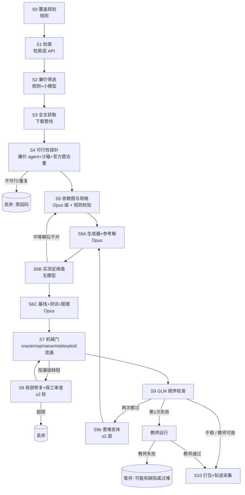

# TB-Science 训练题出题管线 v2：设计文档（草案，2026-11-05）

状态：只写设计，没有写生产代码，也没有调用 LLM 生成题目。凡是标“估算”的数字都还没有验证；凡是标“待定”的事项都需要项目负责人决定。旧管线的数字可以用 `docs/evidence/recompute_numbers.py` 只读复算，新管线的成本估算可以用 `docs/evidence/cost_model.py` 复算。

## 0. 摘要（一页）

**现状问题**（旧管线 = `tbs-datapipe-20261015/pipeline/tbsdata/`，运行记录 = `runs/st-corpus410-20261027/`）

1. **token 花得多，而且花在后段。** 309 篇论文实际进入流程（410 篇全文中另有 81 篇沿用旧结果），合格 244 道（79%）。共 1,684 次 Opus 调用，输入 2,109 万 token，输出 2,719 万 token（其中 thinking 占 54%），平均每道合格题约 11 万输出。合成与修复的输出里有 616 万（24.4%）花在最终被淘汰的题上。每次修复都要求“重新输出全部文件”，单次修复输出中位数约 1.9 万。和官方题去重放在合成之后，第一次静态检查有 96/305 题因为与官方题 TF-IDF 相似度超过 0.30 被打回，这部分修复花了 191 万输出。
2. **题目质量问题都是生成完才发现。** 300 道题进入首次验证，226 道没过：参考解没过 199，中等解拉不开 101，朴素解没失败 41，隐藏偏移不成立 21。原因是阈值在参考解实际运行之前就写死了。人工复审又丢掉 6 道题：公开的黑盒 Oracle 对象把最优解或私有参数暴露给了解题者。另有 1 道题的公开协方差可以反解出目标值（列在 8 道“修复”题里）。作者模型自己写的“作弊基线”只在 2 道题上失败过，没有拦住这些泄漏。
3. **题太简单、太短、太单一。** GLM-5.3 在 238 道新题上跑 714 次，通过 523 次（73.2%）；129 道题 3/3 全过。同一时期 GLM-5.3 在官方题上用 Claude Code 只过了 7/64。新题专家时长 0.4–0.6 h，官方中位 12 h。319 道自建题全是“`solution_cli.py` + 隐藏偏移评测 + numpy/scipy/pandas/sklearn”这一种形态。原因之一是出题提示词把题目强制限定为 20–40 分钟、3–6 个判据、数据 <5 MB（`shorttask.py:33-56`）。另外，从官方题派生的目标（133 题）和从方法主题派生的目标（105 题），GLM 通过率都是 73.2%：难度由出题模板决定，和选题来源关系不大。

**改动要点**

1. **按覆盖缺口出题。** 用“领域 × 方法族”主格加上产出形态、数据形态、设计压力的配额来决定出什么题；优先补 GLM-5.3 在官方题上三种 harness 都没做出的 54 道题所在的格子。
2. **生成前先探针。** 先用廉价模型在沙箱里确认数据或代码能拿到、核心计算能在终端里跑通，并和官方题去重，确认后才调用 Opus。
3. **依赖图驱动的分阶段生成。** 先画“信息依赖图”（从交付物倒推需要哪些前提，并标明每个前提由谁提供）。生成顺序：先写数据生成器和参考解并实际运行，再按实测指标定阈值，最后写基线、测试和题面。修复时只回传改动的文件。
4. **机械门里加一道独立的泄漏检查。** 逐项检查“隐藏真值能否从公开对象求出”：数值扫描、对象自省，再加一个看不到生成过程的廉价模型做反解攻击。
5. **按 GLM 难度校准。** GLM 先跑 1 次：没过就交给教师模型跑；过了再跑第 2 次。只保留 GLM 做不稳、而教师能做出的题。两次都过的题自动生成更难的变体。
6. **按产出形态做模板化打包，轨迹保存原生记录和代理日志。**

**预期收益（估算，未验证）**：用“每道合格且难度合适的题”计成本。旧管线约 25.7 万 Opus 输出、约 $85（其中 GLM 校准约 $75）。新管线基准估算约 15 万 Opus 输出、约 $57（乐观 $44，悲观 $99）。GLM 校准仍是最大的一项（占 70–90%），所以节省主要来自“顺序校准”把每题 GLM 运行次数从 3 次降到约 1.7 次，Opus 侧的节省排在其次。题目若真的变长，单次 GLM 运行成本会上升，总价可能高于旧管线（见 §4.4）。

**需要项目负责人决定**（详见 §8）：是否允许以官方题为目标的论文；长程题比例与专家时长档位；每日预算档位和校准并发；校准与教师用哪个 harness、哪个模型；“难度合适”的判定口径；证明题和交互题是否纳入；廉价模型选型，以及能否用 GLM-5.3 本身做构造角色；对照实验用历史结果还是重跑旧管线。

---

## 1. 现状基线（旧管线实测数字及出处）

| 项 | 数值 | 出处 |
|---|---|---|
| 进入流程论文 / 合格题 | 309 / 244（79%）；410 篇全文中另有 81 篇沿用旧结果，18 篇被阻塞 | `runs/st-corpus410-20261027/README.md`；`tasks/*/_record.json`（`validated=true` 且 `oracle_reward=1`） |
| Opus 调用 | 1,684 次（Opus 1,560，Astra 回退 65，失败 59）；拒答 63 次 | `guard/calls.sqlite` 的 `calls` 表 |
| token | 输入 21,090,933；输出 27,194,133，其中 thinking 14,620,263（54%） | 同上 `usage` 字段 |
| 合成 / 修复输出 | 合成 305 次 17.37M（中位 5.6 万/次）；修复 382 次 7.90M（中位 1.87 万/次，输入中位 2.6 万）；卡片与泄漏检查约 1.92M | `events.jsonl` 的 `S2_synth`、`S2_repair` |
| 花在被淘汰题上的输出 | 6.16M / 25.27M（24.4%） | 同上，按 `_record.json` 结局分组 |
| 首次验证失败（300 题进入） | 226 题失败：G2 参考解不过 199，G3b 中等解拉不开 101，G3 朴素解没失败 41，G6 隐藏偏移不成立 21，G1 非确定 19，G7 阈值没写明 13，G3c 作弊基线没失败 2 | `events.jsonl` 每题第一条 `S3_validate` 的 `gates` |
| 修复输出按触发原因 | 验证门 5.72M，去污染 1.91M，泄漏 0.27M | `events.jsonl`，按修复前最后一个检查事件归类 |
| 首次静态检查失败 | 96/305，全部是与官方题 TF-IDF 余弦 >0.30 | `events.jsonl` 的 `S2b_static.decontam` |
| 合格题修复轮数 | 0 轮 51，1 轮 117，2 轮 76 | `tasks/*/_record.json` 的 `repairs_used` |
| 运行时长 | 2026-10-27 17:24 至 10-30 05:32，约 60 h，2 个 worker；大调用（>3 万输出）中位 8.5 min，约 108 token/s | `events.jsonl`；`calls.sqlite` |
| 人工复审 | 175 用 v2 seed0，55 用最新修订，修 8，丢 6（黑盒预算题的公开 Oracle 暴露最优解，agent 在容器内是 root，题内无法修） | `out/tbs-simple-final-20261031/README.md`、`REVIEW_DECISIONS.jsonl`、`fix_list_B.json` |
| GLM-5.3 在新题上 | 238 题 × 3 次 = 714 次，通过 523（73.2%）；按题 3/3 129、2/3 53、1/3 30、0/3 26；单次运行中位 60.6 min，输出中位 18.3 万，输入中位 862 万；Harbor 记录 `cost_usd` 合计 $7,085（634 次有记录，均值 $11.2） | `tbs-aliyun/jobs/glm53-n244all-cc280/*/result.json` |
| 顺序运行的可预测性 | 第 1 次失败 63 题；第 1 次通过 175 题，其中第 2 次失败 29 题；前两次都过的 146 题中 129 题（88%）3/3。第 1 次通过且用时 <30 min 的 17 题中 15 题 3/3 | 同上，按 `started_at` 排序 |
| 教师在 GLM 0/3 题上 | 26 题全部尝试，23 题至少过 1 次；138 次运行中 104 次 `UnknownApiError`；记录成本 $290 | `tbs-aliyun/jobs/opus-teacher-glm-missing46-cc280/*/result.json` |
| GLM-5.3 在官方 65 题上（快照 11-05 20:22） | Claude Code 2.1.280：7/64 有分且通过，中位 189 min；Codex：2/64，中位 48 min；DSH：4/65，中位 239 min。任一 harness 做出的题只有 11 道，**54 道三种 harness 都没做出** | `tbs-aliyun/glm53-official65*/state/slots-live.json` |
| 官方题形态 | 专家时长中位 12 h；产出 ANS 23、PROG 16、MULTI 11、DOMF 7、CODE 4、PROOF 4、TRAJ 3、DESIGN 2；未做出的 54 题中设计压力 LONG 28、DEPTH 22、DOMAIN 19、TOOL 13 | `tbs-traj2env-20261104/frameworks/coverage_official70.csv`、`REPORT.md` |
| 失败分类 | 提前收工按口径 12–44%（主因 33.2%），方法太简单 22.8%，子问题未解 9.8%，缺领域知识 9.3%，指标不对 9.3% | `tbs-traj2bench-20261104/experiments/repr_compare/REPORT.md` |

**“难度合适”的旧口径**：GLM 3 次里过 1–2 次（83 题），或 0/3 但教师做出（23 题），合计 106 题。旧管线每道难度合适的题平均消耗 Opus 输出 25.7 万、输入 19.9 万，GLM 运行 6.7 次，教师运行 1.3 次。

---

## 2. 题目对象

### 2.1 组成

一道题是一个目录。只有 `pkg/` 打包进 Harbor，`_spec/` 和 `_ledger/` 留在出题侧，不进入解题环境。

| 部件 | 位置 | 说明 | 谁写 |
|---|---|---|---|
| 题面 | `pkg/instruction.md` | 只能包含依赖图中标为“题面给出”的节点；写明交付物、判据名称、方向和阈值（沿用旧 G7）。时间预算按档位写 | Opus 草拟，规则检查 |
| 任务配置 | `pkg/task.toml` | 资源、超时、镜像、专家时长估计、覆盖标签 | 模板生成 |
| 公开输入 | `pkg/environment/data/` | 真实数据切片（需过许可检查）或生成器输出的公开部分 | 生成器产出 |
| 环境 | `pkg/environment/Dockerfile` | 按工具链选基础镜像（Python 科学栈 / R / GDAL / astropy / nibabel / Lean 等） | 模板 + 探针确定依赖 |
| 隐藏真值 | `pkg/tests/truth/`、`pkg/tests/hidden/` | 真值、隐藏评测输入（分布偏移）。解题阶段不在容器里 | 生成器产出 |
| verifier | `pkg/tests/test.sh` + `test_*.py` + `_metrics.py` | 二值 reward = 全部判据通过；分项指标写入 `metrics.jsonl` | Opus 写判据，模板注入公共部分 |
| 参考解 | `pkg/solution/solve.sh` | oracle，必须以余量通过 | Opus |
| 生成器 | `_spec/generator/` | 有确定种子；生成公开数据、隐藏数据、真值；不进镜像 | Opus |
| 基线 | `_spec/baselines/{nop,naive,mid,exploit_*}` | nop：什么都不做；naive：删掉多个关键推导节点；mid：只删一个关键推导节点（见 2.3）；exploit：针对已知捷径的作弊尝试 | 机械推出 + Opus |
| 信息依赖图 | `_spec/depgraph.json` | 见 2.3 | Opus 起草，规则校验 |
| 题目规格 | `_spec/spec.json` | 产出形态、判据列表、阈值规则、难度档位、预期专家时长 | Opus |
| 覆盖标签 | `_spec/coverage.json` | A1 领域、A2 主/次方法族、A3 数据形态、A4 产出类型、A5 设计压力、EDAM/GAMS 锚点（沿用 `frameworks/axes_draft.md`） | 规则 + 廉价模型 |
| 来源 | `_spec/provenance.json` | DOI、全文哈希、检索查询与排名、数据与代码许可、可行性探针记录 | 自动 |
| 账本 | `_ledger/` | 每阶段的输入哈希、模型、token、费用、结论 | 自动 |

### 2.2 产出形态

代码沿用 `axes_draft.md` 的 A4。

| 形态 | 交付物 | verifier 怎么判 | 隐藏真值 | 官方题数 | 纳入阶段 |
|---|---|---|---|---|---|
| ANS 答案文件 | JSON/CSV 数值或标签 | 按容差比较真值；分项指标 | 真值文件 | 23 | MVP |
| PROG 可重跑程序 | `solution_cli.py` 或指定入口 | 在隐藏偏移输入上运行，并比较指标（旧模板 `templates_metrics.py` v0.3，以 `nobody` 身份运行） | 隐藏输入 + 真值 | 16 | MVP（不再作为默认形态，设配额上限） |
| DOMF 领域原生格式 | NIfTI/FITS/netCDF/GeoTIFF/VCF/SDF/mtx 等 | 先用领域库解析并检查格式合法，再比较其中的数值 | 真值数组或对象 | 7 | MVP（只限有 pip 可装读写库的格式） |
| CODE 改已有代码 / 修 bug | 对给定仓库快照打补丁 | 隐藏单元测试 + 在隐藏输入上的数值回归；同时检查没有删改公开测试 | 隐藏测试 + 参考补丁 | 4 | 第 2 期（要求论文代码仓库的许可允许再分发） |
| MULTI 多文件报告 | 结果目录：表格、数据、结构化摘要 JSON | 只判结构化部分（字段、数值、文件之间是否一致）；不用 LLM 给文字打分 | 各文件的真值 | 11 | 第 2 期 |
| DESIGN 设计参数 | 参数文件 | 用模拟器评估目标值和约束 | 模拟器（不进镜像，验证时才挂载） | 2 | 第 2 期 |
| TRAJ/INTERACT 交互 | 查询日志 + 结果 | Oracle 必须在独立进程或独立容器里运行，只通过接口访问；查询预算由服务端计数 | 服务端私有状态 | 3 | 第 3 期（旧管线丢的 6 题都是这一类，必须先解决隔离问题） |
| PROOF 证明 | Lean 源文件 | Lean 内核检查 + 禁止 `sorry`/新公理（`#print axioms`） | 无（定理陈述本身公开） | 4 | 待定，见下 |

**证明类的利弊**

- 有利：
  - verifier 是精确的二值判定，不存在“隐藏真值泄漏”的问题，阈值也没有可调的余地；
  - 官方有 4 道证明题（`finite-free-stam`、`gen-turan-paths`、`onsager-ising-lean`、`regularized-game-proof`），自建题一道都没有；
  - GLM 在 Claude Code 下做出过 `regularized-game-proof`，说明它有一定基础，适合做训练。
- 不利：
  - 需要 Lean + Mathlib 镜像（体积大、构建慢），每道题的环境成本高；
  - 从论文中挑出“有现成证明、规模又适合终端”的命题很难，很可能要由 Opus 先完成形式化，单题成本和失败率都不确定；
  - 难度难以控制：命题稍改，难度就可能跳到教师也做不出；
  - 官方 4 题的专家时长是 24–600 h，短证明题和官方题差距很大；
  - 需要专门防作弊（`sorry`、`axiom`、`native_decide`、改 Mathlib）。
- 建议（待定）：MVP 不纳入。第 3 期先做小配额试点（≤5%），只选已有 Mathlib 基础、教师能在 2 h 内做出的命题，单独核算成本。

### 2.3 信息依赖图

借鉴 WorkFactory 的反向信息依赖图（`workfactory/NOTES.md` §1.2、§3 第 1 项），改成科学计算版。

```json
{
  "deliverables": ["D1"],
  "nodes": [
    {"id": "D1", "kind": "deliverable", "desc": "hidden-set RMSE of reconstructed field", "metric": "rmse", "direction": "<="},
    {"id": "C1", "kind": "compute", "desc": "regularized inversion with L-curve choice", "method_family": "INV", "key": true},
    {"id": "P1", "kind": "premise", "desc": "forward operator kernel", "provision": "given_file", "carrier": "data/kernel.npz"},
    {"id": "P2", "kind": "premise", "desc": "noise level sigma", "provision": "derive", "carrier": null},
    {"id": "H1", "kind": "premise", "desc": "true field on hidden geometry", "provision": "hidden_truth"},
    {"id": "S1", "kind": "shift", "desc": "hidden set uses 2x coarser sampling", "provision": "internal"}
  ],
  "edges": [["P1","C1"],["P2","C1"],["C1","D1"],["S1","D1"]],
  "mid_drop": ["P2"], "naive_drop": ["P2","C1"],
  "difficulty_knobs": {"derive_nodes": 2, "chain_len": 3, "files_crossed": 2, "nonstd_tool": false}
}
```

- `provision` 的取值：`given_instruction`（题面给出）、`given_file`（数据文件给出）、`derive`（解题者自己推导）、`internal`（只在生成器内部使用）、`hidden_truth`（隐藏真值）。
- 机械规则：
  1. `derive`、`internal`、`hidden_truth` 节点的值不得出现在题面或公开文件中（§3 S7 的泄漏门逐项检查）；
  2. mid 基线 = 去掉 `mid_drop` 指定的一个关键推导节点，改用朴素默认值；naive 基线 = 去掉 `naive_drop`。中等解和朴素解之间的差距由图结构保证，不需要让模型去猜；
  3. 难度旋钮包括推导节点数、链长、跨文件数、是否用非标准工具链。生成更难的变体时只允许调这些旋钮，不允许靠隐藏信息或模糊题面增加难度（§3 S9b）。
- 一篇论文可以派生出同一张图上不同深度的多道题。对照实验里每篇只计 1 道题（变体单独计数）。

---

## 3. 阶段划分



### 3.1 阶段表

token 都是**每个进入该阶段的条目**的估算，未验证。价格占位：Opus 级每百万输入 $5、输出 $25；廉价模型每百万输入 $0.5、输出 $2（均为假设，需用实际账单替换）。

| 阶段 | 输入 | 输出 | 模型 | 每条目预估 | 依据 | 失败去向 | 断点续跑状态 |
|---|---|---|---|---|---|---|---|
| S0 覆盖规划 | 覆盖轴与配额；现有题库标签（官方 70、自建 319、v2 已产出）；GLM 官方 65 题三 harness 结果 | 格子工单：格子 ID、目标题数、要求的产出形态与压力、种子主题、查询模板 | 无（规则打分）；可选廉价模型改写查询 | 可忽略 | — | 配额满的格子不再派单 | `plan.sqlite`：cells、orders，按日快照 |
| S1 检索 | 工单 | 候选论文 JSONL（见 §3.2 接口） | 检索层（OpenAlex 主源，S2/Exa/Tavily 由并行任务接入） | OpenAlex 约 $0.006/目标，12–14 次调用 | `search_api/REPORT.md` | 无结果：格子标“稀疏”，下次放宽查询 | `retr_cache.sqlite` 按查询哈希缓存；`seen` 表按 DOI 去重 |
| S2 廉价筛选 | 题录 + 摘要 | 打分与预测标签（是否方法论文、可否计算复现、数据/代码线索、可能的产出形态） | 规则 + 小模型 | 约 3K 输入 / 0.3K 输出 | 估算 | 低分：丢弃并留原因码 | `screen` 表，按 (DOI, 规则版本, 模型) 幂等 |
| S3 全文获取 | DOI、OA 链接 | 全文 + 标题身份校验 | 无（沿用 `ledger.py` 渠道与限额） | 0 token | `download/REPORT.md`（全局 1,500 ok/天） | 进 browser 队列或跳过 | 沿用 `ledger.sqlite` |
| S4 可行性探针 | 全文 + 工单 | 可行性卡：核心计算、数据与代码来源及许可、依赖、实测运行时间、候选产出形态、与官方题的相似度、结论 | 廉价 agent 模型，在沙箱里跑 ≤20 min：下载数据或代码、装依赖、跑最小复现；官方题去重用规则（TF-IDF/13-gram/嵌入） | 输入 25–80 万（大部分命中缓存）/ 输出 1–1.5 万 | WorkFactory 探针每题约 360 万 token（Table 8，主要是输入）；本设计限时 20 min，估得更低 | 不可行或与官方题重复：丢弃，留原因码；可疑：暂存 | `probe/<doi>/`：沙箱日志、卡片；整阶段只在完成后提交 |
| S5 依赖图与规格 | 全文摘录 + 可行性卡 + 工单 | `depgraph.json`、`spec.json`、`coverage.json` | Opus 级；规格探针用廉价模型（只看题面草稿和公开文件描述，列出缺失信息和矛盾） | Opus 4 万 / 1 万；廉价模型 3 万 / 3K | 旧卡片 + 泄漏检查约 6.2K 输出/篇 | 校验不过：同阶段重试 1 次，仍不过则丢弃 | `spec/` 带内容哈希 |
| S6A 生成器 + 参考解 | 规格 | `generator/`、`solution/`，以及沙箱实测：确定性（2 个种子）、运行时间、公开集和隐藏集指标 | Opus 级 | 3 万 / 2.5 万 | 旧合成中位 5.6 万输出/次，其中 generator+solution 约占 39% 字节（`NOTES.md` §2） | 运行失败：转 S8 修复 | `gen/A/` + `run_A.json` |
| S6B 定阈值 | S6A 实测指标 + mid 基线（由依赖图机械推出，或由 Opus 写成小文件）的实测指标 | 阈值 = 参考解与 mid 之间按规则取值，留余量 | 无 | 0 | 旧 G2 首验失败 199 题，主因是阈值先于实测 | 拉不开：回 S5 换 `mid_drop` 节点（只限 1 次） | `thresholds.json` |
| S6C 基线 + 测试 + 题面 | 规格 + 阈值 + S6A | `baselines/`、`tests/`、`instruction.md` | Opus 级 | 4.5 万 / 1.5 万 | 估算 | 转 S7 | `gen/C/` |
| S7 机械门 | 完整题目 | 门结果 + 缺陷类别 | 无模型；反解攻击用廉价模型 | 计算资源为主；反解攻击约 20 万输入 / 2 万输出 | 估算 | 阻塞级缺陷转 S8；非阻塞级缺陷用程序修 | `gates/<attempt>.json` |
| S8 局部修复 + 保工审查 | 失败门的日志 + 相关文件 | 只包含改动文件的补丁；审查结论 | 修复用 Opus 级；审查先做机械 diff，再由廉价模型复核 | Opus 3.5 万 / 0.6 万（旧修复每次 1.87 万输出，因为要重写全部文件） | 估算 | 2 轮后仍不过：丢弃 | `repair/<round>/`（补丁 + 审查） |
| S9 难度校准 | 通过 S7 的题 | 难度标签：hard / unstable / easy | GLM-5.3（学生）、教师模型，都在阿里云沙箱用 Harbor 运行 | 每题平均约 1.7 次 GLM 运行 + 0.4 次教师运行；单次 GLM 约 $11（旧短题） | 旧数据顺序复算得 1.735 次/题 | 教师也做不出：暂存，抽检 | `calib/<task>/<run>.json`，保留原生轨迹 |
| S9b 更难变体 | easy 题 + 依赖图 | 新规格（只调难度旋钮） | Opus 级 | 4.5 万 / 1.5 万 + 后续 S6–S9 | 估算 | 变体深度 ≤2，超过后丢弃或以 easy 标签入库 | 变体沿用父题 lineage |
| S10 打包 + 轨迹采集 | 合格题 + 校准轨迹 | Harbor 包、SFT 候选、manifest | 无 | 0 | 沿用 `package.py` 与 `pack_v2.py` 的做法 | 格式校验不过：修模板 | `release/<date>/` 不可变快照 |

### 3.2 与检索层的接口

检索层目录：`retrieval/`（包名 `tbsretr`，11-05 查看时只有骨架）。本设计只约定接口。

```python
class RetrievalClient(Protocol):
    def search(self, order: CellOrder, k: int = 50) -> list[Candidate]: ...
    def expand(self, seed_ids: list[str], mode: Literal["co_ref", "cites"]) -> list[Candidate]: ...
    def resolve(self, ident: str) -> Candidate | None: ...          # DOI / arXiv / OpenAlex ID
    def cost_today(self) -> dict[str, float]: ...                   # 每个源的调用次数与估计费用

@dataclass
class CellOrder:   # S0 产出
    cell_id: str; field: str; method_family: str; anchors: list[str]
    want_output: list[str]; want_pressure: list[str]; seed_tasks: list[str]
    exclude_dois: list[str]; budget_calls: int

@dataclass
class Candidate:
    ids: dict            # doi / arxiv / openalex / s2
    title: str; abstract: str | None; year: int | None; venue: str | None
    oa_url: str | None; code_urls: list[str]; data_urls: list[str]
    openalex_subfields: list[str]; cited_by: int | None
    provenance: list[dict]   # [{source, query, rank, retrieved_at}]
```

约定：
- 检索层负责去重合并、缓存和限速，按源记账，并通过 `cost_today()` 报给预算账本；
- 出题侧不直接调用任何搜索 API；
- S2/Exa/Tavily 没有 key 时由检索层降级处理，出题侧不感知。

### 3.3 机械门（S7）

| 门 | 判定 | 沿用 / 新增 |
|---|---|---|
| oracle | 参考解在 Harbor 中 reward=1，并且每个判据都有余量 | 沿用（旧 G2 + Harbor oracle） |
| nop | 空交付 reward=0 | 沿用 |
| 确定性 | 2 个种子下生成器和 verifier 结果一致 | 沿用 G1 |
| naive / mid | naive 明显不过；mid 只差 1–2 个判据（近失败） | 沿用 G3/G3b，基线改由依赖图推出 |
| 隐藏偏移 | 只对 PROG/CODE：参考解在隐藏集上仍过，只在公开集调参的方案在隐藏集上不过 | 沿用 G6 |
| 阈值写明 | 题面写明每个判据的阈值和方向 | 沿用 G7 |
| exploit | 作者写的作弊尝试都失败 | 沿用 G3c |
| **泄漏 L1 文本** | 题面、公开文件中不含 `derive`/`internal`/`hidden_truth` 节点的名称或值 | 新增（依赖图驱动） |
| **泄漏 L2 数值扫描** | 遍历所有公开文件（文本、JSON、CSV、npz/npy、pickle、HDF5），检查是否有数组或标量在 verifier 容差内等于真值或其简单变换（转置、排序、取负、缩放） | 新增 |
| **泄漏 L3 自省** | 导入每个公开 Python 模块或对象，遍历属性（含私有属性、闭包、全局变量、`__dict__`）查找真值 | 新增（针对丢掉的 6 道黑盒题） |
| **泄漏 L4 反解攻击** | 独立的廉价 agent 只拿公开对象，限时 20 min 尝试求出真值。提示里列出已知旁路：协方差或设计矩阵可逆、种子可推、文件名或排序带标签、元数据。求出值落在容差内即判泄漏 | 新增（针对 `fix_list_B.json` 中“公开 design covariance 可反解目标”这类问题） |
| **隔离** | 解题阶段容器内没有 `tests/`、真值、生成器；交互类 Oracle 不与解题进程同在一个容器 | 新增（复审结论：agent 在容器内是 root，权限隔离无效） |

缺陷按 WorkFactory 的 8 类统计（缺证据、跨文件不一致、推导断裂、请求欠明确、泄漏/捷径、执行不可行、自相矛盾、事实错误），只用于统计和对照，不决定是否触发修复。是否触发修复按阻塞级判断：oracle、隐藏偏移、泄漏、执行不可行属于阻塞级，要调用 Opus；阈值没写明、非确定、超时设置可以用程序修。

### 3.4 修复与保工审查（S8）

- 修复输入：失败门的日志 + 依赖图 + 相关文件。输出只包含改动的文件；文件数量、文件类型、依赖图结构都不能改。
- 保工审查分两步：
  1. 机械 diff：判据数不能减少；阈值只能按 S6B 的规则重算，不能人为放宽；`derive` 节点仍然存在；题面没有新增 `derive`/`hidden_truth` 节点的内容；
  2. 廉价模型对照原规格复核“核心计算是否还在”。
- 最多 2 轮，超过就丢弃（沿用旧上限）。旧数据里“修复放宽阈值”是否真的发生过还没有核实。建议在实施前用旧 `events.jsonl` 对比修复前后的阈值和判据数，核实一次（只读，无需调用 LLM）。

### 3.5 难度校准（S9）

- **运行顺序**：GLM 第 1 次。
  - 没过 → 教师第 1 次：教师通过记 **hard**；教师没过就再跑 1 次，仍没过记“可能有缺陷或过难”，暂存并抽检。
  - 通过 → GLM 第 2 次：没过记 **unstable**；通过记 **easy**，进入 S9b。
  - 第 1 次通过且用时少于阈值（建议 30 min，待定）可以直接记 easy，省掉第 2 次。旧数据中满足这一条件的 17 题里有 15 题是 3/3。
- **保留口径（待定）**：hard 和 unstable 都保留（对应旧口径的“GLM 做不稳且教师能做”）。easy 进入变体流程，变体失败时以 easy 标签入库，不进 SFT 主集。
- **依据**：旧 238 题按这个顺序复算，平均 1.735 次 GLM 运行/题，3 次固定运行要 3 次。前两次都过的 146 题中 129 题是 3/3，说明“两次都过”可以近似当作“太容易”。
- **单次判定的噪声**：第 1 次失败的 63 题中 37 题后来至少过了 1 次。hard 和 unstable 的界线不稳，但两类都保留，所以对去留影响不大。
- **harness**：建议沿用官方榜单配置 Claude Code 2.1.280，使校准结果与官方评测可比（待定）。Codex 在官方题上中位只跑 48 min，比 Claude Code 的 189 min 便宜得多，但通过的题不同（cc280 过 7 题，Codex 过 2 题）。如果用 Codex 校准，结论能否迁移到 Claude Code 还需要验证。
- **变体（S9b）**：只调依赖图的难度旋钮：多加 1 个 `derive` 节点、加长链、加入跨文件依赖、要求领域原生格式、换非标准工具链、加入病态子问题。禁止的做法：删除题面中必要的信息、模糊判据、减少公开数据使题目不可解。变体要重新走 S6–S9；深度 ≤2。

---

## 4. 成本模型

### 4.1 主指标

- **每道“合格且难度合适”的题的成本**：分别记 Opus 输出 token、Opus 输入 token、廉价模型费用、GLM 运行次数与费用、教师运行次数与费用，以及它们换算后的美元总和。
- **分子**：S0–S9 全部开销，包括被丢弃条目花掉的部分。
- **分母**：S9 判为 hard（教师通过）或 unstable 的题数，加上同样落在这两档的变体数。
- **辅助指标**：每阶段通过率；被丢弃条目花掉的 token 占比；每道合格题的 SFT 可用行数（GLM 自身通过轨迹 + 教师轨迹）；非 PROG 形态占比；预估专家时长分布。

### 4.2 旧管线基线（实测，价格为占位）

| 项 | 合计 | 每道合格题（244） | 每道难度合适的题（106） |
|---|---|---|---|
| Opus 输出 | 27.19M | 11.1 万 | 25.7 万 |
| Opus 输入 | 21.09M | 8.6 万 | 19.9 万 |
| Opus 美元（$5/$25 占位） | $785 | $3.2 | $7.4 |
| GLM 运行 | 714 次，Harbor 记录 $7,085（634 次有费用） | 2.9 次 | 6.7 次，约 $75（按 714 次外推） |
| 教师运行 | 138 次，记录 $290 | — | 1.3 次，约 $2.7 |
| 合计 | — | — | **约 $85** |

注意：
- 旧管线跑 GLM 是为了给 SFT 选轨迹，并不是出题流程的一部分；这里计入，是为了和新管线口径一致；
- Harbor 的 `cost_usd` 来自 LiteLLM 价格表，不等于实际账单（GLM 走托管 API，实际价格未知）。

### 4.3 新管线估算（未验证）

模型：`docs/evidence/cost_model.py`。按每 100 篇检索候选论文计算。主要假设见脚本注释，其中最敏感的四项：可行性探针通过率、机械门通过率、GLM 第 1 次失败率（旧 26%，新目标 40%）、单次 GLM 运行费用。

| 情景 | 难度合适题 / 100 篇候选 | Opus 输出 / 题 | Opus 输入 / 题 | Opus $ / 题 | 廉价模型 $ / 题 | GLM 运行 / 题 | 教师运行 / 题 | 合计 $ / 题（GLM $11.2/次） | 合计 $ / 题（GLM $30/次） |
|---|---|---|---|---|---|---|---|---|---|
| 乐观 | 14.9 | 11.1 万 | 28.9 万 | $4.2 | $0.5 | 2.9 | 1.2 | **$44** | $98 |
| 基准 | 9.4 | 14.9 万 | 40.5 万 | $5.8 | $1.2 | 3.8 | 1.2 | **$57** | $129 |
| 悲观 | 3.4 | 38.2 万 | 83.2 万 | $13.7 | $5.6 | 6.1 | 1.9 | **$99** | $214 |
| 旧管线（实测） | — | 25.7 万 | 19.9 万 | $7.4 | 0 | 6.7 | 1.3 | **$85** | — |

基准情景下，每道难度合适的题的 Opus 输出构成：规格约 2.0 万、生成器 + 参考解约 4.4 万、基线 + 测试 + 题面约 2.6 万、修复约 0.8 万、变体约 0.7 万，其余来自被丢弃的条目。

解读：
1. **GLM 校准占总成本的 70–90%。** 把“每题固定跑 3 次”改成顺序运行（约 1.7 次）是最大的一项节省。Opus 侧在基准情景下约省 42% 输出，与 WorkFactory 笔记估的 30–35% 量级一致。
2. **题目变难会推高 GLM 单次费用。** 旧新题单次约 $11、60 min；官方题在 Claude Code 下单次中位约 $29.5、189 min（`slots-live.json` 的 `cost_usd`）。题目一旦接近官方时长，GLM $30/次那一列更接近真实情况，合计会超过旧管线。因此“题更难”和“每题更便宜”有冲突，需要按训练价值取舍（§8 第 2、3 项）。
3. **悲观情景下 Opus 输出比旧管线还多。** 这发生在可行性探针淘汰过多、机械门通过率低的时候。对照实验（§6）的主要目的就是测出这几个通过率。
4. **抵消项**：GLM 的通过运行本身就是 SFT 数据（自采样通过轨迹）。如果按“每条 SFT 可用行的成本”计算，GLM 运行有一部分不算浪费。

### 4.4 常驻运行、预算与停止规则

- **两条队列**：
  - 生成队列：S0–S8 单并发常驻；
  - 校准队列：S9 在阿里云沙箱，并发单独设置（待定，建议 2–4）。
  - 按基准估算，每道难度合适的题约需 23 min Opus 生成时间（14.9 万输出 ÷ 108 token/s）和约 4 h GLM 运行时间（3.8 次 × 60 min）。瓶颈在校准队列。
- **每日预算档位（候选，待定）**：

  | 档位 | 每日总上限 | 预计难度合适题/天（基准，GLM $11/次） | 需要的校准并发 |
  |---|---|---|---|
  | A | $150 | 约 2–3 | 1 |
  | B | $400 | 约 7 | 2–3 |
  | C | $1,000 | 约 17 | 4–6 |

- **硬上限**：沿用 `run_guard.py` 的“先预留再调用，失败也计数”。分别按天设上限：
  - Opus：调用次数、输出 token、美元；
  - 廉价模型：美元；
  - GLM 运行次数；
  - 教师运行次数。

  另设每条目上限：每篇论文 Opus 调用 ≤6 次（规格 1、S6A 1、S6C 1、修复 2、变体 1）、GLM 运行 ≤4 次（含变体）、教师运行 ≤2 次。
- **超限停止**：任一日上限用到 100% 时，队列在当前调用结束后暂停到次日 00:00（CST），不提前占用次日额度。
- **熔断**（满足任一条就暂停并发报告，等人工处理）：
  - 最近 20 次 Opus 调用中拒答超过 10%；
  - 连续 5 次 API 错误；
  - 最近 10 个条目的机械门通过率低于 30%（通常说明有系统性 bug）；
  - 产出满 5 道合格题后，滚动的每题成本超过基准估算的 2 倍；
  - 阿里云 429 比例连续 30 min 超过 50%（早前试点曾遇到 79% 的 429）。
- **每日报告**（写入文件；是否推送到即时通讯待定）：
  1. 各阶段漏斗计数和丢弃原因的前几名；
  2. 按阶段、按模型的 token 与美元，与预算的对比；
  3. 当日及 7 日滚动的“每道难度合适题成本”，与 §4.3 基准对比；
  4. 覆盖格子：配额完成度和新填的格子；
  5. 难度分布（hard / unstable / easy / 暂存）和变体成功率；
  6. 缺陷 8 类计数，泄漏门命中明细；
  7. 待人工处理清单（暂存题、熔断事件）；
  8. 次日计划派单。
- **断点续跑**：
  - 每个条目在 `state.sqlite` 中有一个状态机记录：阶段、尝试次数、输入哈希、产物哈希、租约到期时间；
  - LLM 输出按提示词哈希缓存（沿用旧 `calls.sqlite` 的 `prompt_hash`）；
  - 重启后，租约过期且阶段幂等的条目自动重新入队；
  - 已经失败终止的条目不自动重放，沿用旧 README 的做法，防止无限重试和覆盖旧结果；
  - 每日 `release/` 快照不可变。

---

## 5. 模型分配

只写角色要求。候选模型都是工作区里已经接入过的（来源：`tbsdata/llm.py`、内部记录、`tbs-aliyun/jobs/`），最终选择全部待定。

| 角色 | 环节 | 要求 | 候选（待定） |
|---|---|---|---|
| 筛选员 | S2，以及 S0 的查询改写 | 便宜、快，能输出结构化 JSON，读摘要即可 | `deepseek-flash`；`gpt-6-astra` |
| 探针员 | S4 可行性探针、S5 规格探针 | 便宜，能在沙箱里用终端工具，长上下文可缓存 | `deepseek-flash` + Claude Code；`glm-5.3`（见下方说明） |
| 作者 | S5 依赖图与规格、S6A、S6C、S8 阻塞级修复、S9b 变体 | 科学正确性和代码质量都要高；旧数据中拒答率 3.7%（63/1,684），需要回退 | `claude-opus-5-5`（现用）；回退 `gpt-6-astra` |
| 审查员 | S7 反解攻击、S8 保工审查 | 和作者分开调用，看不到生成过程；最好和作者不是同一模型家族 | `deepseek-flash`；`gpt-6-astra` |
| 学生 | S9 校准 | 固定 | `glm-5.3` |
| 教师 | S9 教师运行、SFT 教师轨迹 | 在 TBS 上通过率高；现有 Opus 教师轨迹的 thinking 是 API 返回的摘要，不是原始思维链 | `claude-opus-5-5` + Claude Code（现用，官方题单次通过率 63.3%，内部记录） |

需要决定：能否用 GLM-5.3 做探针员。好处是 S4 就能提前发现“GLM 很容易做”的题。坏处是它会让构造过程向学生的能力分布倾斜，而且这些运行和校准运行不好区分，记账时容易混在一起。

---

## 6. 与训练的接口

- **SFT 数据来源**：
  1. **GLM 自采样通过轨迹**：unstable 题上 GLM 自己通过的那次运行，标 `lane=self_rollout`，做法同 `out/tbs-sft-mindforge-v2/README.md`；
  2. **教师轨迹**：hard 题上教师通过的运行，标 `teacher=true`，单独成组；
  3. **前缀屏蔽续写**：hard 题上 GLM 失败的轨迹交给 Stage 1（traj2bench）。先定位开始犯错的步，在新容器里恢复现场，再让 GLM 续做（同模型重采样，或注入不泄漏答案的提示），也可以换教师续做。续做通过后，犯错之前的前缀只作上下文、不计 loss（训练框架的行级 `loss_mask`）。
- **与 Stage 1 的关系**：Stage 1 原本只在官方题上做，存在过拟合风险，对外汇报时也需要披露。v2 题目带可执行 verifier 和依赖图，可以作为 Stage 1 的新环境来源。依赖图里的 `derive` 节点还能帮助定位“开始犯错的步”，例如判断模型是不是跳过了某个推导节点。Stage 2 负责补“不会”的部分（知识和方法），Stage 1 负责纠正“会但没做对”的部分；两者共用恢复运行时和 verifier。
- **轨迹保存**（依据 `repr_compare/REPORT.md` 结论 3–5）：
  - 主记录用 harness 的原生日志：
    - Claude Code：session jsonl + `claude-code.txt` 的 result 行 + Harbor `result.json`；
    - Codex：rollout jsonl；
    - DSH：`session.jsonl.zstd`；
  - 有代理时同时保存代理日志 `model-proxy/requests-*.jsonl`，作为判断流是否完整、模型实际收到了什么的权威来源；
  - ATIF 只作为派生的阅读格式。Codex 的 ATIF 不能用来做 bad pattern 检测（缺推理、缺工具报错标记、缺压缩事件）。
- **轨迹筛选**：沿用 `tbs-traj-review-20261102/PROTOCOL.md` 的 E1–E4 排除和 R1–R5 排序。每条记录都要标出是否收到过 `date_change` 提醒、是否读过 `tests/`。
- **数据划分**：train/dev 按 DOI 和覆盖格子同时分组，避免同一篇论文或同一个依赖图派生的题跨划分。与官方题做两层去重：S4 前移一次，S10 打包时再做 13-gram 和文件哈希检查。

---

## 7. 验收与对照实验

### 7.1 同 20 篇论文对照（AB-20）

- **选样**：从旧运行的 309 篇中按结局分层，用哈希确定性抽样（`sha256("tbs-v2-ab20|"+task_id)` 升序取前 N，脚本 `recompute_numbers.py` 的 `ab20()`）：
  - 旧题 3/3（8 篇）；
  - 旧题 1–2/3（5 篇）；
  - 旧题 0/3（2 篇）；
  - 旧管线淘汰（4 篇）；
  - 复审因泄漏丢弃（1 篇，`doi-851f175aa5503aad`）。

  这 20 篇在旧管线上共用 Opus 输出 182.6 万。按 3 次运行口径，旧管线在其中得到 7 道难度合适的题（1–2/3 的 5 道 + 0/3 且教师做出的 2 道），约合 26 万 Opus 输出/题。
- **旧组**：默认直接用历史记录，不重跑，节省预算。可选：抽其中 5 篇重跑旧管线，检查服务端或模型行为有没有漂移（约 50 万 Opus 输出）。
- **新组**：同样 20 篇，从 S3 之后开始跑（全文已有），每篇最多产出 1 道题 + 变体。
- **新组预算上限**：
  - Opus 输出 ≤250 万（约为旧组的 1.4 倍，给变体和探针留余量）；
  - 廉价模型 ≤$50；
  - GLM 运行 ≤60 次；
  - 教师运行 ≤20 次。

  用到上限就停止，按已完成部分计算指标。
- **指标**：

| 指标 | 定义 | 旧组来源 |
|---|---|---|
| 难度合适题数 | hard + unstable（含变体） | 旧 GLM 3 次运行 + 教师结果 |
| Opus 输出 / 难度合适题 | 含被丢弃条目 | `events.jsonl` |
| 合计 $ / 难度合适题 | 价格同 §4 | 同上 + Harbor `cost_usd` |
| 被丢弃条目花掉的输出占比 | — | 同上 |
| 首次机械门通过率 | — | `S3_validate` |
| GLM 第 1 次通过率 | — | 按 `started_at` 排序后的第 1 次 |
| 非 PROG 形态占比 | — | 全部是 PROG |
| 泄漏 | 由独立审查员（人工或另一模型，看不到生成过程）对两组各抽 10 题盲审 | 复审记录 |
| 预估专家时长 / 教师用时 | 教师运行时间中位数可以作为难度的辅助指标 | 教师作业记录 |

- **判定标准（预先登记）**：新组同时满足以下四条才判为“优于旧管线”：
  1. 难度合适题数 ≥7；
  2. Opus 输出 / 难度合适题 ≤18 万（旧组的 0.7 倍）；
  3. 合计 $ / 难度合适题不高于旧组；
  4. 盲审泄漏 0 题，且非 PROG 形态 ≥30%。

  只满足 1、4 而成本超标，记为“质量改善、成本未达标”。题数 <5 记为失败。题数在 5–6 之间判为结论不足，追加 20 篇（同一抽样规则，从各层继续往下取）再判。
- **局限**：20 篇样本小，通过率的置信区间很宽，只能发现大的差异。旧组 GLM 用的是 3 次运行，新组用顺序运行。主判定用旧组的 3 次运行口径（7 道）。辅助口径：用旧组前两次运行按 §3.5 重新计算，确定的有 3 道（1 道 unstable + 2 道 0/3 且教师做出）；另有 3 道是第 1 次失败但后来通过、当时没有跑教师，标为“教师结果缺失”。如有需要，可补跑这 3 题的教师运行（约 $20）。

### 7.2 MVP 范围

**纳入**：
- S3–S10（全文已有的固定论文清单，可以直接跑 AB-20）；
- 产出形态 ANS、PROG、DOMF；
- 依赖图、分阶段生成、补丁式修复、保工审查（机械 diff + 廉价模型复核）；
- 泄漏门 L1–L4 和隔离检查；
- 顺序校准 + 变体（深度 1）；
- 预算账本、熔断、每日报告文件；
- 原生轨迹归档。

**不纳入**：
- S0–S2（等检索层接口稳定后接入）；
- CODE、MULTI、DESIGN（第 2 期）；
- 交互类、证明类（第 3 期，待定）；
- 即时通讯推送；
- 多篇论文合成一道题。

**实施顺序**（每一步完成后先跑通再进入下一步）：
1. 状态库 + 预算账本 + 熔断 + 每日报告。复用 `run_guard.py` 的预留模型，先用假模型做干跑。
2. 题目对象 schema、依赖图 schema 和校验器；用旧 244 题中的 10 题手工补依赖图，验证 schema 表达得了这些题。
3. 机械门套件：复用 `templates_metrics.py`、`decontam.py`，新增泄漏 L2/L3。**先在旧题上回测**：L2/L3 应该能抓出复审丢掉的 6 题和 `fix_list_B.json` 中的协方差泄漏题。这一步不调用 LLM。
4. S4 可行性探针（廉价 agent + 沙箱）和前移的官方题去重。用 AB-20 的 20 篇试跑，人工抽查结论。
5. S5/S6 分阶段生成 + S6B 阈值规则 + S8 补丁修复与保工审查。
6. 泄漏 L4 反解攻击（廉价模型）。
7. S9 顺序校准，接 `tbs-aliyun` 现有作业脚本；变体深度 1。
8. S10 打包模板（ANS/PROG/DOMF 各一套）+ 轨迹归档 + SFT 导出（复用 `pack_v2.py` 规则）。
9. 跑 AB-20，按 §7.1 判定，写报告，再决定是否接入 S0–S2 常驻运行。

---

## 8. 风险与需要项目负责人决定的事项

### 8.1 需要决定

| # | 事项 | 选项 | 建议（未定） |
|---|---|---|---|
| 1 | 是否允许以官方题为目标的论文 | a) 允许，但做两层去重；b) 只允许方法主题；c) 允许但单独划分、单独披露 | a 或 c。旧管线 180/309 篇来自官方题目标，而两类目标的 GLM 通过率相同（73.2%），说明来源本身不决定难度。训练会用到官方题相关知识，对外需要披露（11-03 决定） |
| 2 | 长程题比例与专家时长档位 | 例如 T1 1–2 h、T2 2–6 h、T3 ≥6 h，比例 50/40/10 或 30/50/20 | 先用 50/40/10 跑 AB-20，按 GLM 单次成本再调 |
| 3 | 每日预算档位与校准并发 | §4.4 的 A/B/C | AB-20 之前不常驻；AB-20 通过后从 A 档开始 |
| 4 | 校准 harness | Claude Code 2.1.280（与官方榜单一致）/ Codex（便宜约 4 倍时长）/ DSH | Claude Code。用 Codex 要先验证结论能否迁移 |
| 5 | 教师模型与 harness | 现用 Opus 5.5 + Claude Code；其他 | 维持现用；104/138 次 `UnknownApiError` 需要先排查 |
| 6 | “难度合适”口径 | hard + unstable / 只要 unstable / 加上教师也做不出的题（留给 RL） | hard + unstable；教师做不出的题单独入库，供 RL 使用 |
| 7 | 证明题、交互题 | 纳入时间和配额 | 证明题第 3 期 ≤5% 试点；交互题等隔离方案验证后再定 |
| 8 | 廉价模型选型；GLM-5.3 能否担任构造角色 | `deepseek-flash` / `gpt-6-astra` / `glm-5.3` | 构造角色不用学生模型 |
| 9 | 任务容器能否联网装包 | 禁止 / 白名单镜像源 | 禁止，依赖全部在镜像中准备好（与 E1 排除规则一致） |
| 10 | 一篇论文派生多道题 | 允许 / 不允许 | 允许，最多 2 道且深度不同，train/dev 按 DOI 分组 |
| 11 | 人工抽检比例 | 例如每 20 道合格题抽 2 道 | 前 50 道每 10 道抽 1 道，之后每 20 道抽 1 道 |
| 12 | AB-20 旧组是否重跑 | 用历史记录 / 重跑 5 篇查漂移 | 用历史记录 |
| 13 | 检索 key | OpenAlex 免费 key、S2 key | 申请 OpenAlex key（`search_api/REPORT.md` 结论 2） |

### 8.2 风险

| 风险 | 影响 | 缓解 |
|---|---|---|
| GLM 校准成本主导，且随题目变长而上升 | 每题成本可能高于旧管线 | 顺序校准；快速通过直接判 easy；报告里同时给出“每条 SFT 行成本” |
| 变体靠“藏信息”变难，而不是靠增加科学深度 | 训练价值低，可能教出坏习惯 | 只允许调依赖图旋钮；保工审查检查题面信息不能减少；人工抽检变体 |
| 教师做不出时，分不清是题有缺陷还是题太难 | 误丢好题，或误留坏题 | 暂存，抽检教师轨迹；L4 攻击和规格探针提前发现欠明确的题 |
| 泄漏检查不完备 | 训练数据里混入“走捷径”的示范 | L1–L4 + 隔离；轨迹筛选按 E1 排除读取 tests/truth 的轨迹；盲审抽检 |
| 单次运行判难度噪声大 | hard/unstable 误判 | 两档都保留，所以误判影响小；easy 需要两次都过才判 |
| 可行性探针淘汰过多 | 漏斗变窄，悲观情景 | AB-20 测出探针通过率；探针结论分“不可行 / 可疑”，可疑的进入人工复核 |
| 阿里云 / 模型 API 限流（429） | 校准队列阻塞 | 熔断 + 429 指标进日报；校准并发可以调 |
| 针对 GLM 弱点过拟合 | 题目分布偏向 GLM 特有的失误 | 覆盖配额按官方题分布加权，难度信号只用来取舍，不用来决定题型 |
| 数据和代码许可 | 不能再分发 | S4 记录许可；CODE 形态只用允许再分发的仓库 |
| 成本估算全部未验证 | 决策依据不足 | AB-20 先测，再决定常驻档位 |
| 旧 Opus 教师轨迹的 thinking 是摘要 | 教师轨迹风格和 GLM 不一致 | 教师轨迹单独成组，与自采样分开评估（沿用 v2 做法） |

---

## 附：文件

- `DESIGN.md`：本文件。
- `docs/evidence/recompute_numbers.py`：只读复算 §1 和 §7.1 的旧管线数字（不调用 LLM，不写文件）。
- `docs/evidence/cost_model.py`：§4.3 的漏斗成本模型，参数都是假设，可以直接改参数重算。


---

## 已定决策 2026-11-05

项目负责人于 2026-11-05 定下以下 5 条，其余“待定”项保持待定。实现（`gen/`）对待定项取保守默认值，并都做成配置项（见 `gen/README.md`“待定项与默认值”）。

1. **教师模型：Opus。** 出题各阶段（S5/S6A/S6C/S8）的教师角色用 Opus（`claude-opus-5-5`，与旧 `llm.py` 走同一本机网关）。S9 教师分支是 Opus 在 Claude Code 2.1.280 下跑 Harbor（沿用 `run-job-opus.sh` 作业脚本）。
2. **难度校准：GLM-5.3 在 Claude Code 2.1.280 harness 下跑。** 作业配置沿用 `glm53-official65` 的 `ClaudeCodeGlm65` 设置。
3. **“难度合适”的定义：** GLM（CC）按顺序校准时 2 次里通过 1 次（unstable）；或 GLM 0 次通过但 Opus 教师能做出（hard）。两次都通过算 easy，不进主集；GLM 失败、教师也失败的题暂存，留待抽检。
4. **检索去掉 Tavily。** 检索层默认不调用 Tavily（适配器保留，可手动打开做对照）。
5. **每日预算暂不定；全线等新的失败分析结果出来后再量产。** 实现上，真实模型的日预算默认为空，此时真实模型调用一律拒绝，必须显式配置后才能跑；S9 只生成作业配置，默认不提交。
